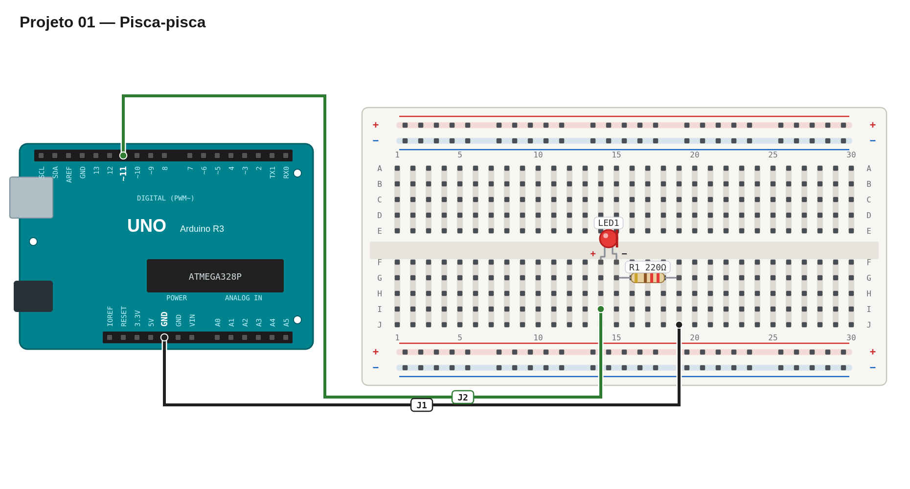

# Régua de avaliação — 01 — Pisca-pisca

Use este roteiro depois da sua primeira tentativa. Ele serve para validar o comportamento e a montagem, não para comparar sua implementação com uma solução específica.

## Pré-checagem

- [ ] A perna longa do LED está ligada ao lado do pino de sinal.
- [ ] A perna curta do LED está ligada ao lado do resistor.
- [ ] O resistor de 220 Ω está em série com o LED.
- [ ] O circuito tem retorno ao `GND`.
- [ ] O sketch compila e é enviado para a placa sem erros.

## Cenários de validação

| Cenário | Como testar | Resultado esperado | Status |
| --- | --- | --- | :---: |
| Início | Energize a placa. | O LED começa a piscar sem interação. | ☐ |
| Estado ligado | Observe um ciclo completo. | LED fica aceso por aproximadamente 1 segundo. | ☐ |
| Estado desligado | Observe o mesmo ciclo. | LED fica apagado por aproximadamente 1 segundo. | ☐ |
| Repetição | Aguarde vários ciclos. | O padrão continua estável. | ☐ |

## Avaliação

| Critério | OK | Parcial | Não atende |
| --- | :---: | :---: | :---: |
| Montagem correta e segura | ☐ | ☐ | ☐ |
| LED com polaridade correta | ☐ | ☐ | ☐ |
| Uso de resistor limitador de corrente | ☐ | ☐ | ☐ |
| Temporização próxima de 1 segundo por estado | ☐ | ☐ | ☐ |
| Código legível e pino identificável | ☐ | ☐ | ☐ |

## Erros comuns a investigar

- O LED não acende: confira a polaridade e se as duas pernas estão em linhas elétricas diferentes.
- O LED fica sempre aceso ou apagado: confira se o pino foi configurado como saída e se o estado é alternado.
- O LED parece muito fraco: confira a continuidade do circuito e a posição do resistor.
- O LED não acende de jeito nenhum: teste invertendo-o com a placa desconectada.

## Conclusão

- [ ] A entrega atende à parte obrigatória.
- [ ] Registrei o que ainda preciso corrigir ou entender.

Referência de montagem (uma solução possível)

A disposição física dos componentes é apenas uma sugestão. Você pode usar outras posições na protoboard, desde que preserve as conexões, polaridades e o comportamento esperado.

[Ver arquivo editável do diagrama](diagram.json)

