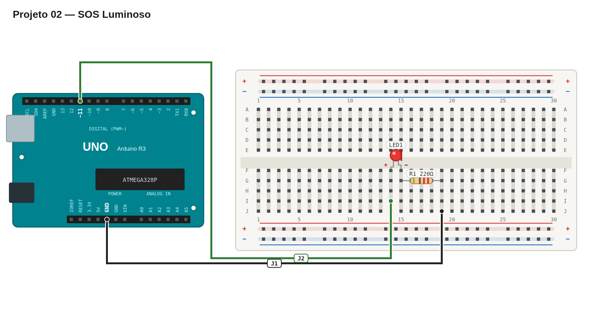

# Régua de avaliação — 02 — SOS luminoso

Use este roteiro depois da sua primeira tentativa. Ele serve para validar o comportamento e a montagem, não para comparar sua implementação com uma solução específica.

## Pré-checagem

- [ ] A montagem elétrica é a mesma do projeto 1: pino `11` → LED → resistor → `GND`.
- [ ] O LED está com a polaridade correta.
- [ ] O sketch compila e é enviado para a placa sem erros.

## Cenários de validação

| Cenário | Como testar | Resultado esperado | Status |
| --- | --- | --- | :---: |
| Primeiro grupo | Observe o início da mensagem. | Três flashes curtos. | ☐ |
| Grupo central | Continue observando. | Três flashes longos. | ☐ |
| Último grupo | Continue observando. | Três flashes curtos. | ☐ |
| Pausa final | Aguarde o fim da mensagem. | LED fica apagado por alguns segundos. | ☐ |
| Repetição | Aguarde após a pausa final. | Uma nova mensagem SOS é iniciada. | ☐ |

## Avaliação

| Critério | OK | Parcial | Não atende |
| --- | :---: | :---: | :---: |
| Montagem correta e segura | ☐ | ☐ | ☐ |
| Padrão `... --- ...` reconhecível | ☐ | ☐ | ☐ |
| Diferença clara entre flash curto e longo | ☐ | ☐ | ☐ |
| Pausas entre grupos e mensagens | ☐ | ☐ | ☐ |
| Código sem repetição desnecessária | ☐ | ☐ | ☐ |

## Erros comuns a investigar

- Pontos e traços parecem iguais: verifique se o tempo do traço é aproximadamente três vezes maior.
- A sequência não parece SOS: conte os flashes de cada grupo antes de ajustar pausas.
- O padrão não recomeça: confirme que a lógica de transmissão está dentro do ciclo principal.

## Conclusão

- [ ] A entrega atende à parte obrigatória.
- [ ] Registrei o que ainda preciso corrigir ou entender.

Referência de montagem (uma solução possível)

A disposição física dos componentes é apenas uma sugestão. Você pode usar outras posições na protoboard, desde que preserve as conexões, polaridades e o comportamento esperado.

[Ver arquivo editável do diagrama](diagram.json)

