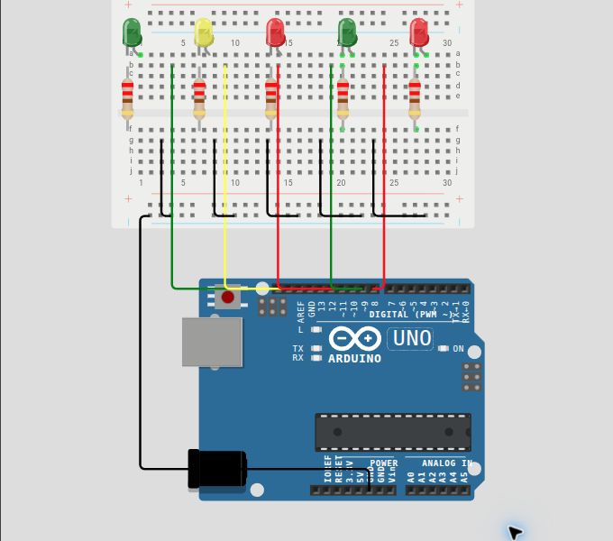

# Régua de avaliação — 04 — Semáforo

Use este roteiro depois da sua primeira tentativa. Ele serve para validar o comportamento e a montagem, não para comparar sua implementação com uma solução específica.

## Pré-checagem

- [ ] Há cinco LEDs: dois vermelhos, dois verdes e um amarelo.
- [ ] Cada LED possui seu próprio resistor de 220 Ω.
- [ ] Todos os retornos dos LEDs chegam ao `GND` comum.
- [ ] Os pinos 8 a 12 correspondem aos sinais definidos no subject.
- [ ] O sketch compila e é enviado para a placa sem erros.

## Cenários de validação

| Cenário | Como testar | Resultado esperado | Status |
| --- | --- | --- | :---: |
| Início do ciclo | Ligue a placa. | Carros no verde; pedestres no vermelho. | ☐ |
| Atenção | Aguarde cerca de 5 segundos. | Carros no amarelo; pedestres continuam no vermelho. | ☐ |
| Travessia | Aguarde mais cerca de 3 segundos. | Carros no vermelho; pedestres no verde. | ☐ |
| Encerramento | Aguarde cerca de 5 segundos. | Verde dos pedestres apaga e vermelho pisca 5 vezes. | ☐ |
| Repetição | Aguarde o fim dos piscas. | O ciclo volta ao estado inicial. | ☐ |

## Avaliação

| Critério | OK | Parcial | Não atende |
| --- | :---: | :---: | :---: |
| Montagem correta e segura | ☐ | ☐ | ☐ |
| Cinco sinais ligados aos pinos corretos | ☐ | ☐ | ☐ |
| Sequência de carros correta | ☐ | ☐ | ☐ |
| Sequência de pedestres correta | ☐ | ☐ | ☐ |
| Estados verdes sem conflito | ☐ | ☐ | ☐ |
| Piscas finais e reinício automático | ☐ | ☐ | ☐ |

## Erros comuns a investigar

- Dois LEDs parecem trocar de papel: confira o mapeamento dos pinos 8 a 12.
- Os dois verdes acendem juntos: revise a transição entre carros e pedestres.
- Um LED não acende: confira a polaridade, o resistor associado e o retorno ao GND.
- O ciclo não volta ao início: confira se os estados anteriores são apagados antes da nova etapa.

## Conclusão

- [ ] A entrega atende à parte obrigatória.
- [ ] Registrei o que ainda preciso corrigir ou entender.

Referência de montagem (uma solução possível)

A disposição física dos componentes é apenas uma sugestão. Você pode usar outras posições na protoboard, desde que preserve as conexões, polaridades e o comportamento esperado.

[Ver arquivo editável do diagrama](diagram.json)

