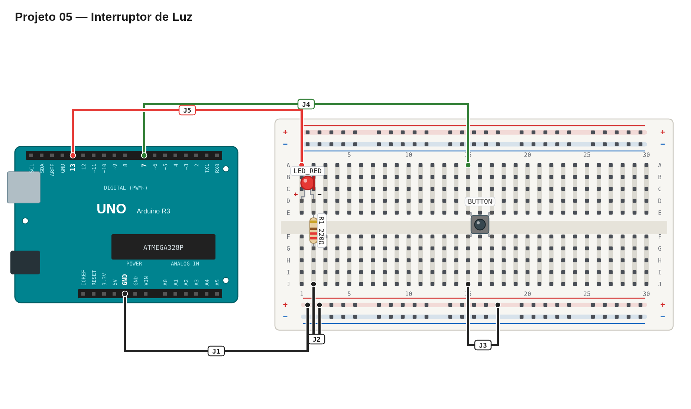

# Régua de avaliação — 05 — Interruptor de luz

## Pré-checagem

- [ ] O botão liga o pino `7` ao `GND`.
- [ ] O pino do botão usa `INPUT_PULLUP`.
- [ ] O LED está em série com um resistor de 220 Ω.
- [ ] O sketch compila e é enviado sem erros.

## Cenários de validação

| Cenário | Resultado esperado | Status |
| --- | --- | :---: |
| Inicialização | LED apagado | ☐ |
| Primeiro clique | LED acende | ☐ |
| Segundo clique | LED apaga | ☐ |
| Botão mantido | Estado muda uma única vez | ☐ |
| Vários cliques | LED alterna de forma previsível | ☐ |

## Avaliação

| Critério | OK | Parcial | Não atende |
| --- | :---: | :---: | :---: |
| Montagem correta e segura | ☐ | ☐ | ☐ |
| Leitura correta com `INPUT_PULLUP` | ☐ | ☐ | ☐ |
| Alternância de estado | ☐ | ☐ | ☐ |
| Proteção contra repetição ao segurar | ☐ | ☐ | ☐ |

## Erros comuns a investigar

- O botão parece invertido: com `INPUT_PULLUP`, pressionado é `LOW`.
- O LED alterna várias vezes: aguarde o botão ser solto antes de aceitar o próximo pressionamento.
- O LED não acende: confira polaridade, resistor e retorno ao GND.

Referência de montagem (uma solução possível)

A disposição física dos componentes é apenas uma sugestão. Você pode usar outras posições na protoboard, desde que preserve as conexões, polaridades e o comportamento esperado.

[Ver arquivo editável do diagrama](diagram.json)

