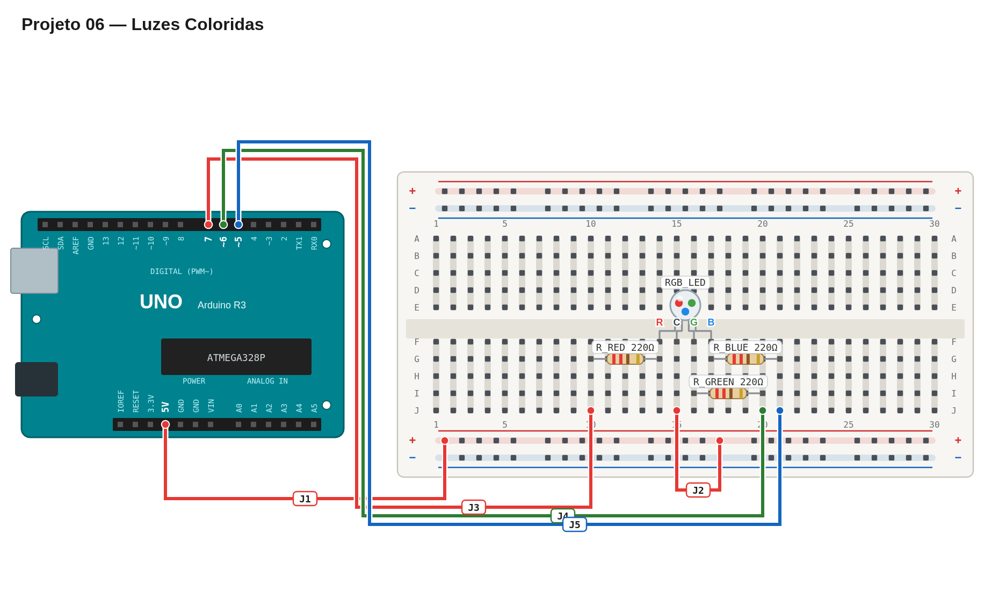

# Régua de avaliação — 06 — Luzes coloridas

## Pré-checagem

- [ ] O terminal comum do LED RGB está no `5V`.
- [ ] Cada canal de cor possui seu próprio resistor de 220 Ω.
- [ ] Os canais vermelho, verde e azul estão nos pinos 7, 6 e 5.
- [ ] O sketch compila e é enviado sem erros.

## Cenários de validação

| Cenário | Resultado esperado | Status |
| --- | --- | :---: |
| Primeiro estado | LED vermelho por cerca de 1 s | ☐ |
| Segundo estado | LED verde por cerca de 1 s | ☐ |
| Terceiro estado | LED azul por cerca de 1 s | ☐ |
| Quarto estado | LED apagado por cerca de 1 s | ☐ |
| Repetição | Sequência reinicia automaticamente | ☐ |

## Avaliação

| Critério | OK | Parcial | Não atende |
| --- | :---: | :---: | :---: |
| Três resistores independentes | ☐ | ☐ | ☐ |
| Cores isoladas e corretas | ☐ | ☐ | ☐ |
| Ordem e temporização corretas | ☐ | ☐ | ☐ |
| Código legível | ☐ | ☐ | ☐ |

## Erros comuns a investigar

- As cores parecem invertidas: revise se o LED é de ânodo comum.
- Uma cor não aparece: confira a ordem física dos terminais do LED RGB.
- A luz fica sempre acesa: em ânodo comum, `HIGH` apaga e `LOW` acende.

Referência de montagem (uma solução possível)

A disposição física dos componentes é apenas uma sugestão. Você pode usar outras posições na protoboard, desde que preserve as conexões, polaridades e o comportamento esperado.

[Ver arquivo editável do diagrama](diagram.json)

