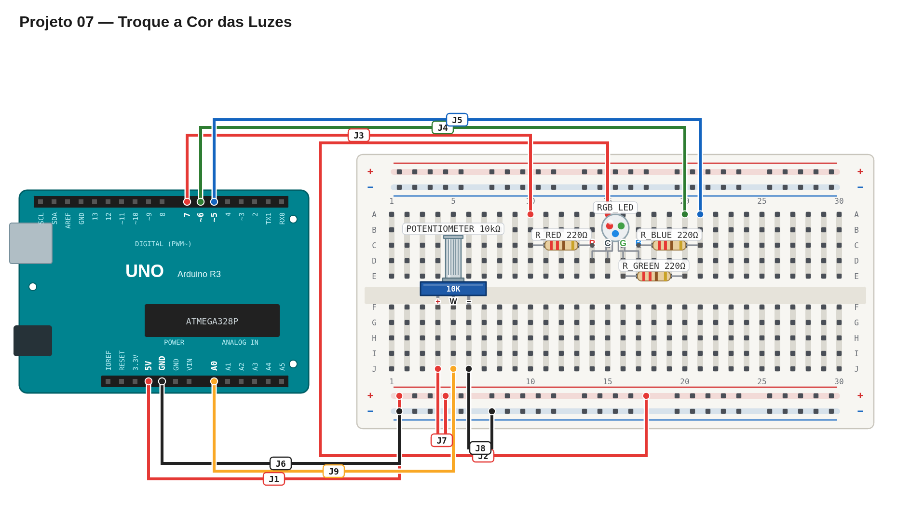

# Régua de avaliação — 07 — Troque a cor das luzes

## Pré-checagem

- [ ] Potenciômetro: terminais externos em `5V` e `GND`; terminal central em `A0`.
- [ ] LED RGB de ânodo comum no `5V`.
- [ ] Cada canal de cor possui resistor próprio de 220 Ω.
- [ ] O sketch compila e é enviado sem erros.

## Cenários de validação

| Posição aproximada | Resultado esperado | Status |
| --- | --- | :---: |
| Primeiro quarto do giro | LED apagado | ☐ |
| Segundo quarto do giro | LED vermelho | ☐ |
| Terceiro quarto do giro | LED verde | ☐ |
| Último quarto do giro | LED azul | ☐ |
| Giro contínuo | Estados mudam sem reiniciar a placa | ☐ |

## Avaliação

| Critério | OK | Parcial | Não atende |
| --- | :---: | :---: | :---: |
| Leitura analógica em `A0` | ☐ | ☐ | ☐ |
| Quatro faixas completas e exclusivas | ☐ | ☐ | ☐ |
| Estados de cor corretos | ☐ | ☐ | ☐ |
| Resposta contínua | ☐ | ☐ | ☐ |

## Erros comuns a investigar

- A leitura não muda: confira o terminal central do potenciômetro.
- Uma faixa parece errada: confira os limites de cada condição.
- Cores invertidas: revise a configuração de ânodo comum e os canais do LED.

Referência de montagem (uma solução possível)

A disposição física dos componentes é apenas uma sugestão. Você pode usar outras posições na protoboard, desde que preserve as conexões, polaridades e o comportamento esperado.

[Ver arquivo editável do diagrama](diagram.json)

