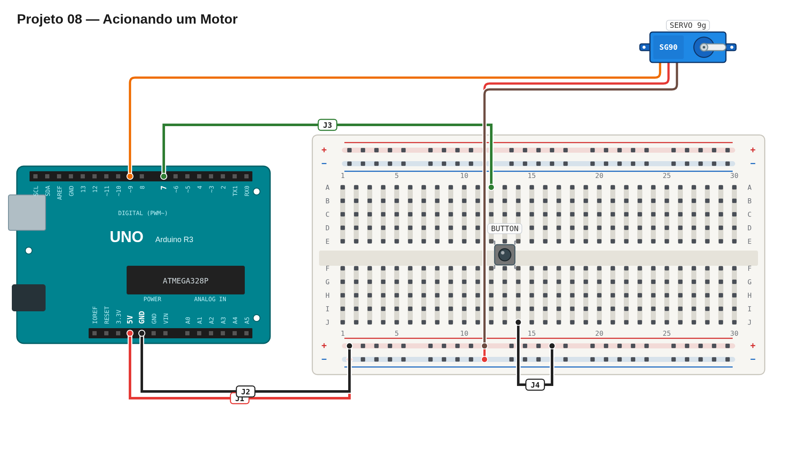

# Régua de avaliação — 08 — Acionando um motor

Use este roteiro depois da sua primeira tentativa. Ele serve para validar o comportamento, não para comparar sua implementação com uma solução específica.

## Pré-checagem

- [ ] O servo está ligado a `5V`, `GND` e a um pino de sinal digital.
- [ ] O botão está entre o pino de leitura e o `GND`.
- [ ] O pino do botão está configurado como `INPUT_PULLUP`.
- [ ] O sketch compila e a placa recebe o programa sem erros.

## Cenários de validação

| Cenário | Como testar | Resultado esperado | Status |
| --- | --- | --- | :---: |
| Repouso | Ligue a placa sem pressionar o botão. | Servo permanece em `0°`. | ☐ |
| Movimento de ida | Pressione o botão. | Servo percorre o caminho até próximo de `180°` de forma visível. | ☐ |
| Movimento de volta | Aguarde o ciclo terminar. | Servo volta de forma gradual a `0°`. | ☐ |
| Repetição | Ative o botão depois do retorno. | Um novo ciclo completo é executado. | ☐ |

## Avaliação

| Critério | OK | Parcial | Não atende |
| --- | :---: | :---: | :---: |
| Montagem correta e segura | ☐ | ☐ | ☐ |
| Leitura do botão com `INPUT_PULLUP` | ☐ | ☐ | ☐ |
| Movimento gradual nos dois sentidos | ☐ | ☐ | ☐ |
| Retorno à posição inicial | ☐ | ☐ | ☐ |
| Código legível e pinos identificáveis | ☐ | ☐ | ☐ |

## Erros comuns a investigar

- O botão parece “invertido”: com `INPUT_PULLUP`, pressionado normalmente significa `LOW`.
- O servo não se move: confira o pino de sinal e o terra comum.
- O Arduino reinicia ou o servo treme: verifique a alimentação antes de mudar o código.

## Conclusão

- [ ] A entrega atende à parte obrigatória.
- [ ] Registrei o que ainda preciso corrigir ou entender.

Referência de montagem (uma solução possível)

A disposição física dos componentes é apenas uma sugestão. Você pode usar outras posições na protoboard, desde que preserve as conexões, polaridades e o comportamento esperado.

[Ver arquivo editável do diagrama](diagram.json)

