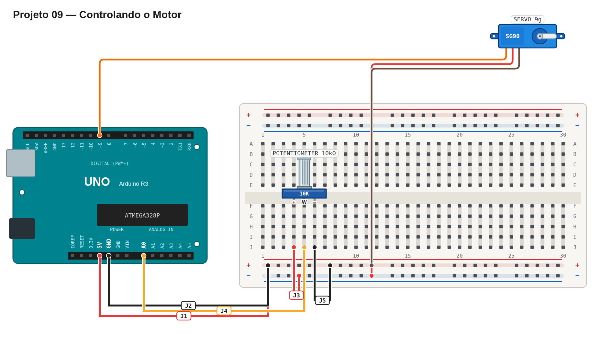

# Régua de avaliação — 09 — Controlando o motor

Use este roteiro depois da sua primeira tentativa. Ele serve para validar o comportamento, não para comparar sua implementação com uma solução específica.

## Pré-checagem

- [ ] Os pinos externos do potenciômetro estão ligados a `5V` e `GND`.
- [ ] O pino central do potenciômetro está ligado a uma entrada analógica.
- [ ] O servo está ligado a `5V`, `GND` e a um pino de sinal digital.
- [ ] O sketch compila e a placa recebe o programa sem erros.

## Cenários de validação

| Cenário | Como testar | Resultado esperado | Status |
| --- | --- | --- | :---: |
| Mínimo | Gire o potenciômetro até o fim em um sentido. | Servo fica próximo de `0°`. | ☐ |
| Meio | Posicione o potenciômetro aproximadamente no meio. | Servo fica próximo de `90°`. | ☐ |
| Máximo | Gire o potenciômetro até o fim no outro sentido. | Servo fica próximo de `180°`. | ☐ |
| Resposta contínua | Gire o potenciômetro devagar, em ambos os sentidos. | Servo acompanha a rotação sem reiniciar a placa. | ☐ |

## Avaliação

| Critério | OK | Parcial | Não atende |
| --- | :---: | :---: | :---: |
| Montagem correta e segura | ☐ | ☐ | ☐ |
| Leitura analógica correta | ☐ | ☐ | ☐ |
| Conversão entre leitura e ângulo | ☐ | ☐ | ☐ |
| Controle contínuo do servo | ☐ | ☐ | ☐ |
| Código legível e pinos identificáveis | ☐ | ☐ | ☐ |

## Erros comuns a investigar

- O servo só vai a uma extremidade: confirme que o pino central do potenciômetro está na entrada analógica.
- O servo percorre apenas parte do curso: confira a conversão da faixa `0–1023` para `0–180`.
- O servo treme ou a placa reinicia: verifique a alimentação e o terra comum.

## Conclusão

- [ ] A entrega atende à parte obrigatória.
- [ ] Registrei o que ainda preciso corrigir ou entender.

Referência de montagem (uma solução possível)

A disposição física dos componentes é apenas uma sugestão. Você pode usar outras posições na protoboard, desde que preserve as conexões, polaridades e o comportamento esperado.

[Ver arquivo editável do diagrama](diagram.json)

