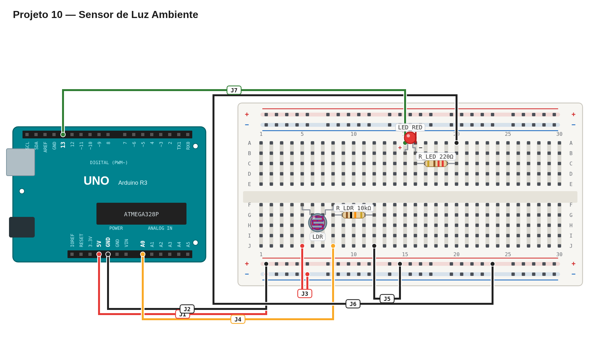

# Régua de avaliação — 10 — Sensor de luz ambiente

## Pré-checagem

- [ ] LDR e resistor de 10 kΩ formam um divisor de tensão.
- [ ] O ponto central está ligado a `A0`.
- [ ] O LED tem resistor de 220 Ω.
- [ ] O sketch compila e é enviado sem erros.

## Cenários de validação

| Cenário | Resultado esperado | Status |
| --- | --- | :---: |
| LDR exposto à luz | LED acende quando a leitura alcança o limiar | ☐ |
| LDR coberto | LED apaga quando a leitura fica abaixo do limiar | ☐ |
| Mudança gradual de luz | Saída responde sem reiniciar a placa | ☐ |

## Avaliação

| Critério | OK | Parcial | Não atende |
| --- | :---: | :---: | :---: |
| Leitura analógica correta | ☐ | ☐ | ☐ |
| Limiar aplicado corretamente | ☐ | ☐ | ☐ |
| LED e resistores corretos | ☐ | ☐ | ☐ |

## Erros comuns a investigar

- LED parece invertido: confira o sentido do divisor de tensão e a comparação.
- Leitura instável: confira as conexões do LDR e do resistor de 10 kΩ.

Referência de montagem (uma solução possível)

A disposição física dos componentes é apenas uma sugestão. Você pode usar outras posições na protoboard, desde que preserve as conexões, polaridades e o comportamento esperado.

[Ver arquivo editável do diagrama](diagram.json)

