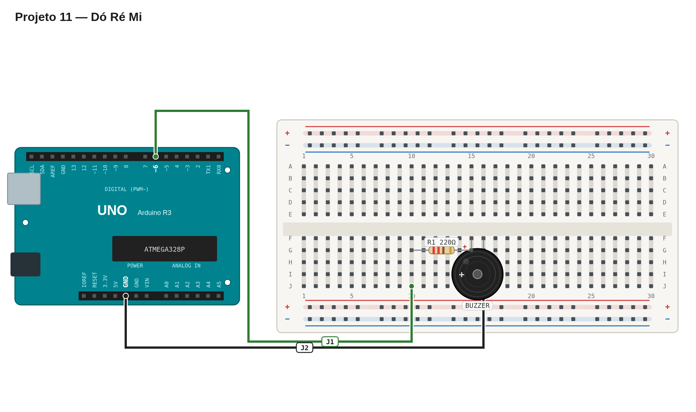

# Régua de avaliação — 11 — Dó ré mi

## Pré-checagem

- [ ] Buzzer ligado ao pino `6`.
- [ ] O sketch compila e é enviado sem erros.

## Cenários de validação

| Cenário | Resultado esperado | Status |
| --- | --- | :---: |
| Início | Primeira nota é Dó | ☐ |
| Sequência | Oito notas sobem até o Dó mais agudo | ☐ |
| Duração | Cada nota dura cerca de 500 ms | ☐ |
| Repetição | Escala reinicia automaticamente | ☐ |

## Avaliação

| Critério | OK | Parcial | Não atende |
| --- | :---: | :---: | :---: |
| Frequências reconhecíveis | ☐ | ☐ | ☐ |
| Ordem correta da escala | ☐ | ☐ | ☐ |
| Uso de array e laço | ☐ | ☐ | ☐ |
| Repetição automática | ☐ | ☐ | ☐ |

Referência de montagem (uma solução possível)

A disposição física dos componentes é apenas uma sugestão. Você pode usar outras posições na protoboard, desde que preserve as conexões, polaridades e o comportamento esperado.

[Ver arquivo editável do diagrama](diagram.json)

