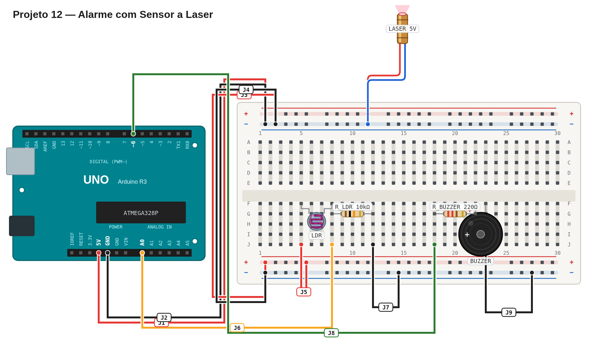

# Régua de avaliação — 12 — Alarme com sensor a laser

## Pré-checagem

- [ ] Laser e LDR estão alinhados.
- [ ] LDR e resistor de 10 kΩ formam divisor de tensão em `A0`.
- [ ] Buzzer está no pino `6`.
- [ ] O sketch compila e é enviado sem erros.

## Cenários de validação

| Cenário | Resultado esperado | Status |
| --- | --- | :---: |
| Feixe livre | Buzzer silencioso | ☐ |
| Feixe bloqueado | Buzzer toca | ☐ |
| Feixe restaurado | Buzzer para | ☐ |

## Avaliação

| Critério | OK | Parcial | Não atende |
| --- | :---: | :---: | :---: |
| Leitura do LDR | ☐ | ☐ | ☐ |
| Limiar de acionamento | ☐ | ☐ | ☐ |
| Alarme sonoro | ☐ | ☐ | ☐ |
| Retorno ao estado silencioso | ☐ | ☐ | ☐ |

Referência de montagem (uma solução possível)

A disposição física dos componentes é apenas uma sugestão. Você pode usar outras posições na protoboard, desde que preserve as conexões, polaridades e o comportamento esperado.

[Ver arquivo editável do diagrama](diagram.json)

