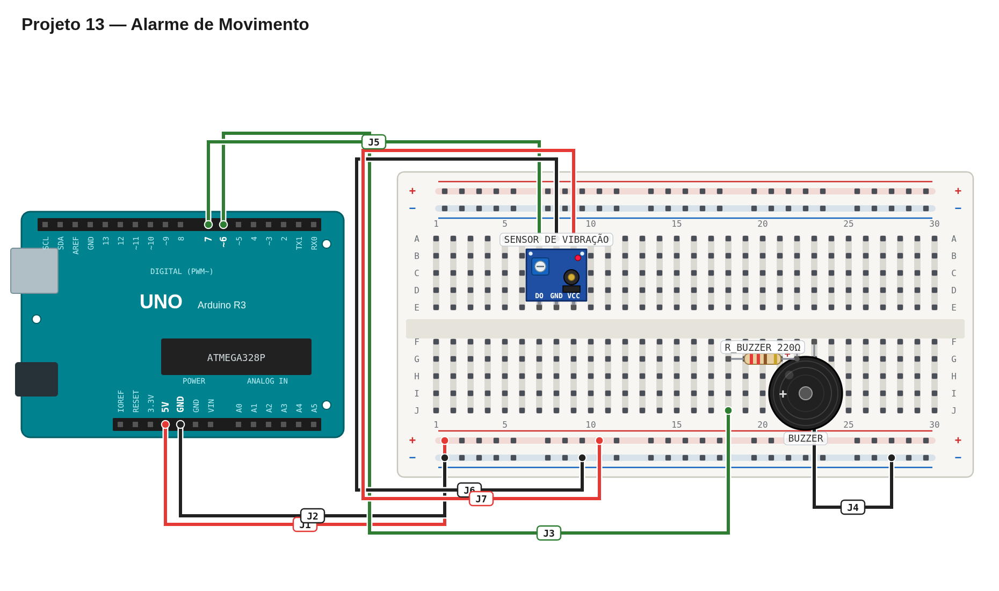

# Régua de avaliação — 13 — Alarme de movimento

## Pré-checagem

- [ ] Sensor conectado ao pino `7`.
- [ ] Buzzer conectado ao pino `6`.
- [ ] Sensibilidade ajustada para detectar uma vibração leve.
- [ ] Sketch compilado e enviado sem erros.

## Cenários de validação

| Cenário | Resultado esperado | Status |
| --- | --- | :---: |
| Repouso | Buzzer desligado | ☐ |
| Vibração | Buzzer toca | ☐ |
| Após cerca de 1 s | Som termina | ☐ |
| Nova vibração | Alarme pode disparar novamente | ☐ |

## Avaliação

| Critério | OK | Parcial | Não atende |
| --- | :---: | :---: | :---: |
| Leitura digital do sensor | ☐ | ☐ | ☐ |
| Sensibilidade adequada | ☐ | ☐ | ☐ |
| Acionamento do buzzer | ☐ | ☐ | ☐ |
| Retorno ao repouso | ☐ | ☐ | ☐ |

Referência de montagem (uma solução possível)

A disposição física dos componentes é apenas uma sugestão. Você pode usar outras posições na protoboard, desde que preserve as conexões, polaridades e o comportamento esperado.

[Ver arquivo editável do diagrama](diagram.json)

