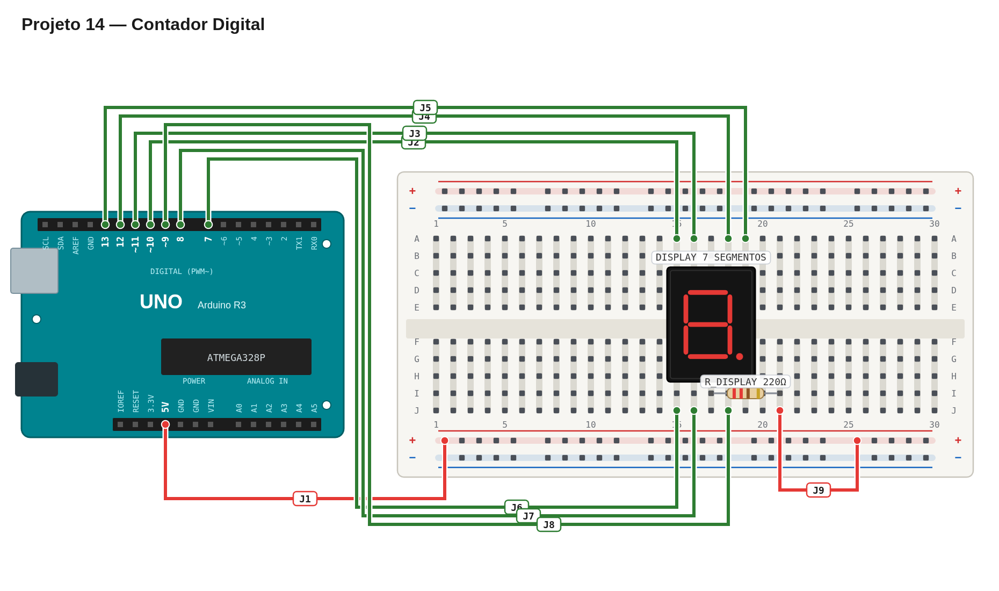

# Régua de avaliação — 14 — Contador digital

## Pré-checagem

- [ ] Display montado com resistor de 220 Ω no terminal comum.
- [ ] Segmentos A–G ligados aos pinos definidos.
- [ ] Sketch compilado e enviado sem erros.

## Cenários de validação

| Cenário | Resultado esperado | Status |
| --- | --- | :---: |
| Início | Dígito 0 | ☐ |
| Contagem | Dígitos 1 a 9 reconhecíveis, um por segundo | ☐ |
| Após o 9 | Contagem volta a 0 | ☐ |

## Avaliação

| Critério | OK | Parcial | Não atende |
| --- | :---: | :---: | :---: |
| Mapeamento dos segmentos | ☐ | ☐ | ☐ |
| Dígitos reconhecíveis | ☐ | ☐ | ☐ |
| Temporização | ☐ | ☐ | ☐ |
| Repetição da contagem | ☐ | ☐ | ☐ |

## Erros comuns a investigar

- Dígitos invertidos: confirme se o display é de ânodo comum.
- Segmento errado: revise a ordem A–G e os pinos.

Referência de montagem (uma solução possível)

A disposição física dos componentes é apenas uma sugestão. Você pode usar outras posições na protoboard, desde que preserve as conexões, polaridades e o comportamento esperado.

[Ver arquivo editável do diagrama](diagram.json)

