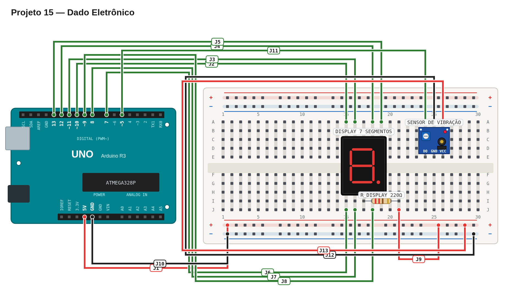

# Régua de avaliação — 15 — Dado eletrônico

## Pré-checagem

- [ ] Display ligado como no projeto 14.
- [ ] Sensor tilt ligado ao pino `5`.
- [ ] Sketch compilado e enviado sem erros.

## Cenários de validação

| Cenário | Resultado esperado | Status |
| --- | --- | :---: |
| Repouso | Display permanece no último valor | ☐ |
| Vibração | Nova rodada é iniciada | ☐ |
| Durante a rodada | Dígitos mudam de forma aleatória | ☐ |
| Final da rodada | Mudanças desaceleram e param | ☐ |
| Nova vibração | Outra rodada ocorre | ☐ |

## Avaliação

| Critério | OK | Parcial | Não atende |
| --- | :---: | :---: | :---: |
| Leitura do sensor tilt | ☐ | ☐ | ☐ |
| Aleatoriedade dos dígitos | ☐ | ☐ | ☐ |
| Desaceleração perceptível | ☐ | ☐ | ☐ |
| Exibição correta no display | ☐ | ☐ | ☐ |

Referência de montagem (uma solução possível)

A disposição física dos componentes é apenas uma sugestão. Você pode usar outras posições na protoboard, desde que preserve as conexões, polaridades e o comportamento esperado.

[Ver arquivo editável do diagrama](diagram.json)

